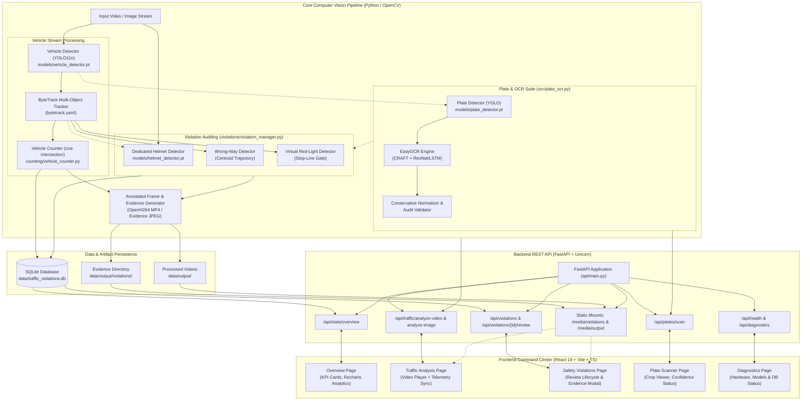
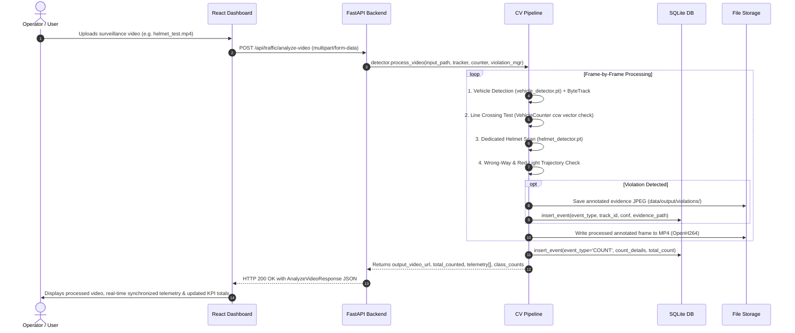

# Document 01: Project Overview & System Architecture

## 1. Executive Summary & Problem Statement

### The Problem
Traditional urban traffic surveillance systems rely heavily on manual human monitoring via Closed-Circuit Television (CCTV) cameras or isolated, single-purpose radar/sensor units. This legacy approach suffers from critical operational bottlenecks:
- **Human Inattention & Fatigue**: Human operators reviewing hours of high-density surveillance footage inevitably suffer from cognitive fatigue, missing fleeting safety infractions such as unhelmeted motorcycle riders, wrong-way movements, or red-light intrusions.
- **Siloed Systems**: In many metropolitan cities, vehicle counting, automatic number plate recognition (ANPR), and traffic violation policing operate as separate, disconnected systems.
- **Traffic Heterogeneity in Developing Nations**: Traffic streams in countries like India feature diverse vehicle classes (buses, cars, auto-rickshaws/three-wheelers, trucks, motorcycles/two-wheelers, vans) with chaotic lane discipline, frequent occlusions, and varied rider postures. Standard off-the-shelf vision systems trained exclusively on Western highway camera feeds fail drastically on ground-level or mixed traffic streams.

### The Solution: Smart Traffic Vision
**Smart Traffic Vision** is an automated, edge-capable Computer Vision and Deep Learning traffic intelligence system. It unifies:
1. **Multi-Class Vehicle Detection**: Utilizing custom-trained lightweight YOLO models (`YOLO11n`) to recognize six vehicle classes simultaneously.
2. **Multi-Object Tracking (MOT)**: Employing **ByteTrack** for persistent identity preservation across successive video frames, resilient against brief occlusions.
3. **Dynamic Virtual-Line Counting**: Computing real-time spatial line-crossing events using vector orientation geometry (`ccw`), logging cumulative and per-frame telemetry.
4. **Safety Violation Auditing**:
   - **Dedicated Spatial Helmet Detection**: Self-bootstrapped two-wheeler localization and rider head-crop analysis using a dedicated YOLO model to flag unhelmeted riders without cross-rider false suppression.
   - **Wrong-Way Movement Analysis**: Centroid trajectory displacement tracking compared against configurable corridor traffic flow vectors.
   - **Virtual Red-Light Intrusion**: Stop-line crossing detection tied to signal state gates.
5. **Automatic Number Plate Localization & OCR**: Detecting plate bounding boxes with YOLO and extracting normalized alphanumeric characters via **EasyOCR** with confidence-based audit tagging.
6. **Automated Evidence Archiving**: Automatically generating high-contrast annotated evidence frames featuring bounding boxes, license tags, timestamp banners, and violation reasons.
7. **Production-Ready Enterprise Stack**: A decoupled, high-throughput **FastAPI** backend coupled with a modern dark-themed **React 19 + TypeScript + Vite** command center dashboard.

---

## 2. Core Objectives & Scope

### Primary Objectives
- **Automate Real-Time Traffic Auditing**: Process live camera feeds and pre-recorded surveillance videos without manual operator intervention.
- **Eliminate Pipeline Bottlenecks**: Ensure safety violation detectors (especially helmet enforcement) operate robustly even if primary vehicle detectors miss unorthodox two-wheeler angles.
- **Prevent Duplicate Penalties**: Guarantee through spatial-temporal tracking, cooldown buffers, and database deduplication constraints that a single vehicle is not penalized multiple times in consecutive frames.
- **Provide Actionable Audit Evidence**: Never log a violation without saving a tamper-evident, annotated visual evidence record showing the vehicle box, rider head box, reason, and timestamp.
- **Zero Hallucination / Conservative OCR**: Never fabricate plate characters; flag unreadable or ambiguous OCR readings as "low-confidence" for human supervisor verification.

### System Scope
| In Scope (Implemented) | Out of Scope (Future Work) |
| :--- | :--- |
| Detection of 6 vehicle categories (`Bus`, `Car`, `Three-Wheeler`, `Truck`, `Two-Wheeler`, `Van`) | Real physical traffic signal hardware interfacing (virtual signal state is used) |
| Dedicated motorcycle helmet & no-helmet detection | Night-time thermal / infrared vision processing |
| Multi-rider spatial disambiguation (driver vs pillion, co-existing riders) | Vehicle speed estimation via calibrated radar/lidar |
| Bidirectional line-crossing vehicle counting | Multi-camera handoff / vehicle re-identification across city grids |
| Centroid-displacement wrong-way driving detection | Automatic challan/fine SMS gateway dispatch |
| License plate detection & EasyOCR character extraction | Real-time GPU cluster streaming at 4K resolution |
| SQLite event logging with structured count persistence | Cloud distributed database synchronization (Postgres/Kafka) |
| FastAPI REST API with OpenAPI documentation | User role-based authentication / JWT auth |
| React 19 control-room dashboard with live charts & review modal | Native mobile application (iOS/Android) |

---

## 3. High-Level System Architecture

The following Mermaid diagram illustrates the architectural separation of concerns across the three core tiers: the **Computer Vision Pipeline**, the **FastAPI Service Layer**, and the **React Dashboard**.

---

## 4. End-to-End Data Flow

The end-to-end data processing lifecycle spans 7 clear stages:

### Stage-by-Stage Breakdown
1. **Upload & Ingestion**: The React frontend sends an MP4 video or JPEG image to `/api/traffic/analyze-video` or `/api/traffic/analyze-image`. Temporary files are safely stored in `data/input/`.
2. **Vehicle Detection & Tracking**: The video frame is passed to `vehicle_detector.pt`. Detections are assigned persistent `track_id` integers across consecutive frames by **ByteTrack**.
3. **Line Crossing & Telemetry**: Vehicle centroids are monitored across a user-defined virtual counting line. When a trajectory line segment intersects the virtual line, cumulative counters increment, and per-frame telemetry is recorded.
4. **Dedicated Helmet-First Detection**: The frame is evaluated by `helmet_detector.pt`. Motorcycles (class 2) and bare heads (`nohelmet`, class 3) are spatially associated. If an unhelmeted rider is confirmed, cooldown is checked, an annotated evidence frame is saved to disk, and a violation row is inserted into SQLite.
5. **Wrong-Way & Stop-Line Checks**: Centroid displacement vectors are compared to the configured traffic flow vector (`down`, `up`, `left`, `right`). Any vehicle crossing the virtual stop-line while signal state is RED is flagged.
6. **Persistence**: Violations, review statuses (`pending`), structured category counts, and normalized plate strings are committed to `data/traffic_violations.db`.
7. **Frontend Visualization**: The operator reviews safety alerts in the **Safety Violations** page, inspects full-resolution evidence snapshots in a modal dialog, and approves or rejects alerts.

---

## 5. System Limitations & Real-World Constraints

To maintain scientific integrity during project presentations and viva defense, the following limitations must be stated candidly:

1. **Camera Angle Dependency**: The primary vehicle detector (`vehicle_detector.pt`) was trained on overhead CCTV perspectives. When presented with ground-level or close-up frontal motorcycle views, it can fail to bound the motorcycle. *(Our dedicated helmet-first detection path explicitly bypasses this bottleneck).*
2. **Virtual Signal Recognition**: The system detects vehicles crossing the stop-line during a configured RED state, but does **not** perform real-time optical recognition of physical traffic signal bulbs.
3. **Lighting & Occlusion in OCR**: Extreme motion blur, dark night environments, bent plates, or non-standard fonts reduce EasyOCR confidence. Ambiguous readings are flagged as `low_confidence` rather than fabricated.
4. **Single-Node Execution**: In the current implementation, inference runs sequentially on a local CPU/GPU using OpenCV `VideoCapture` and `VideoWriter`. It is not yet distributed across streaming clusters (e.g. Apache Kafka or RTSP brokers).

---

## 6. Conceptual Viva Reference (Hinglish & English)

### Hinglish Concept Explanation
> *"Ye project basically ek Intelligent Traffic Management System hai jo 3 main kaam karta hai:*
> 1. *Traffic Counting: Video me aane wali har gaadi ko detect karke track karta hai aur counting line cross karne pe category-wise count karta hai.*
> 2. *Safety Violations: Agar koi bike rider bina helmet ke chal raha ho, ya koi vehicle wrong-way driving kar raha ho, ya red-light jump kar raha ho, toh system turant uski photo khinch kar evidence save karta hai aur database me alert daal deta hai.*
> 3. *ANPR (Automatic Number Plate Recognition): Number plate detect karke EasyOCR se uski alphanumeric value extract karta hai aur verify karta hai.*
> *Sabse khaas baat ye hai ki humne helmet detection ko vehicle detector par dependent nahi rakha — helmet model khud motorcycle aur unhelmeted rider ko spatially associate karke detect karta hai."*

### Formal English Viva Answers (For Speaking Aloud)

**Q1: What is the core objective of the Smart Traffic Vision project?**
> *"The objective of Smart Traffic Vision is to automate real-time traffic monitoring and safety enforcement using Computer Vision. It integrates multi-class vehicle detection, ByteTrack multi-object tracking, virtual-line counting, automated safety violation detection—specifically unhelmeted riders and wrong-way driving—and license plate OCR into a unified FastAPI and React command center."*

**Q2: How does your system prevent duplicate violation records for the same vehicle?**
> *"We employ a three-tier deduplication strategy: first, ByteTrack maintains consistent track IDs across frames; second, our violation detectors enforce a configurable temporal cooldown buffer per track; and third, our SQLite database schema enforces duplicate prevention logic via SQL query validation before committing a new event record."*

**Q3: What was the primary bottleneck in the initial helmet detection pipeline and how did you resolve it?**
> *"Initially, helmet detection depended entirely on the vehicle detector first detecting a two-wheeler and cropping its top 45%. Because the vehicle detector was trained on overhead CCTV, it frequently missed frontal-angle motorcycles or cropped only the lower chassis, leading to zero helmet violation events. We solved this by implementing a dedicated spatial helmet-first path where the helmet model itself detects motorcycles and rider heads across the entire frame, spatially associating them without relying on the vehicle detector."*
