# Document 03: Machine Learning Models & Deep Learning Inference

## 1. Verified Model Inventory

The table below summarizes all deep learning model weight files present in the repository, verified through direct inspection of model metadata, layer graphs, and class definitions:

| Model File | File Size | Base Architecture | Total Classes | Exact Class Map (`names`) | Primary Role in Pipeline |
| :--- | :--- | :--- | :--- | :--- | :--- |
| **`models/vehicle_detector.pt`** | ~5.47 MB | `YOLO11n` (nano) | 6 | `{0: 'Bus', 1: 'Car', 2: 'Three-Wheeler', 3: 'Truck', 4: 'Two-Wheeler', 5: 'Van'}` | Stream vehicle detection, bounding, tracking input |
| **`models/helmet_detector.pt`** | ~5.46 MB | `YOLO11n` (nano) | 5 | `{0: 'Helmet', 1: 'fd', 2: 'motorcycle', 3: 'nohelmet', 4: 'platenumber'}` | Dedicated helmet & motorcycle spatial detection |
| **`models/helmet_detector_backup.pt`** | ~5.45 MB | `YOLO11n` (nano) | 5 | `{0: 'Helmet', 1: 'fd', 2: 'motorcycle', 3: 'nohelmet', 4: 'platenumber'}` | Fallback snapshot of helmet model weights |
| **`models/plate_detector.pt`** | ~6.25 MB | `YOLO` (nano) | 1 | `{0: 'license_plate'}` | License plate region localization |
| **`yolo11n.pt`** (root) | ~5.61 MB | `YOLO11n` (nano) | 80 | Standard COCO classes (`person`, `car`, `motorcycle`, ...) | Base pretrained weights reference checkpoint |
| **`EasyOCR Engine`** (in-memory) | ~45 MB (PyTorch) | CRAFT + ResNet-BiLSTM | N/A (Alphanumeric) | Character sequence recognition | Alphanumeric text extraction from plate crops |

---

## 2. Model Training Provenance: What Is Known vs. Unknown

In academic presentations and viva defense, it is critical **never to claim that models were trained from scratch** unless verified by full training checkpoints and commit logs.

### 1. `vehicle_detector.pt`
- **What is Verified**:
  - The model weights correspond to an Ultralytics `YOLO11n` network fine-tuned on an Indian traffic vehicle dataset.
  - The repository contains two matching dataset folders: `datasets/india_traffic/` and `datasets/india_traffic_detection/`, each containing 901 total annotated images (631 train, 180 valid, 90 test).
  - The dataset configuration file (`datasets/india_traffic/data.yaml`) explicitly references origin from Roboflow under `workspace: kaceys-workspace` with exactly 6 classes: `['Bus', 'Car', 'Three-Wheeler', 'Truck', 'Two-Wheeler', 'Van']`.
- **What is Unknown**:
  - The exact hyperparameters (learning rate schedule, epochs, optimizer, batch size, weight decay) used during the fine-tuning run are not preserved in the repository commit history.
- **Classification**: **Fine-tuned transfer learning** on top of pretrained YOLO11n weights, **NOT** trained from scratch.

---

### 2. `helmet_detector.pt`
- **What is Verified**:
  - Fine-tuned `YOLO11n` model with 5 classes: `{0: 'Helmet', 1: 'fd', 2: 'motorcycle', 3: 'nohelmet', 4: 'platenumber'}`.
  - The repository contains `datasets/motorcycle_helmet/` with 205 annotated images (163 train, 41 valid, 1 test).
  - Its `data.yaml` confirms Roboflow origin under `workspace: traffic-violation`.
  - Class distribution in labels confirms extensive instances of `motorcycle` (class 2), `Helmet` (class 0), and `nohelmet` (class 3).
- **Classification**: **Fine-tuned transfer learning** on domain-specific motorcycle and helmet imagery.

---

### 3. `plate_detector.pt`
- **What is Verified**:
  - Single-class detector with class `{0: 'license_plate'}`.
  - Outputs tight bounding boxes around vehicle registration plates.
- **What is Unknown**:
  - There is no raw training dataset for license plates in the `datasets/` directory. The model file was imported as an optimized pre-trained checkpoint.
- **Classification**: **Pretrained / Fine-tuned external weight artifact**.

---

### 4. EasyOCR Models
- **What is Verified**:
  - EasyOCR automatically downloads and caches two distinct neural networks from its official repository:
    1. **Text Detector**: A **CRAFT** (Character Region Awareness for Text Detection) convolutional network that detects arbitrary-oriented text strings and character affinity heatmaps.
    2. **Text Recognizer**: A deep convolutional-recurrent model consisting of a **ResNet** feature extractor, a **Bidirectional LSTM** (BiLSTM) sequence encoder, and a **CTC** (Connectionist Temporal Classification) decoder.
- **Classification**: **Pretrained open-source deep learning models**; no custom fine-tuning performed on the OCR weights.

---

## 3. Core Computer Vision & Object Detection Concepts

### 1. Object Detection Architecture: YOLO (You Only Look Once)
Unlike legacy two-stage detectors (e.g. Faster R-CNN) that first generate Region Proposals (RPN) and subsequently classify each proposal, YOLO is a **single-stage detector**.
- It treats object detection as a direct regression problem: the entire input image is passed through a convolutional backbone in a single forward pass.
- **YOLO11 Innovations**: Employs an optimized C3k2 backbone, spatial pyramid pooling fast (SPPF), and decoupled anchor-free detection heads that predict bounding box coordinates $(x_1, y_1, x_2, y_2)$, objectness confidence, and class probabilities simultaneously.

### 2. Bounding Box Representation
In our pipeline, bounding boxes are handled in two primary formats:
- **`xyxy`**: Absolute pixel coordinates $[x_1, y_1, x_2, y_2]$ representing the top-left and bottom-right corners. Used for spatial slicing, drawing, and intersection logic.
- **`xywh` / Centroid**: $[x_c, y_c, w, h]$ where $x_c = (x_1 + x_2) / 2$ and $y_c = (y_1 + y_2) / 2$. Used by ByteTrack's Kalman filter to estimate vehicle velocity vectors.

### 3. Intersection over Union (IoU)
IoU measures the spatial overlap between two bounding boxes $A$ and $B$:
$$\text{IoU} = \frac{\text{Area of Overlap}(A \cap B)}{\text{Area of Union}(A \cup B)} = \frac{\text{Area}(A \cap B)}{\text{Area}(A) + \text{Area}(B) - \text{Area}(A \cap B)}$$
- **Usage in our project**:
  - Used in **Non-Maximum Suppression (NMS)** to merge redundant overlapping boxes.
  - Used in **ByteTrack** to compute the cost matrix for Hungarian matching between tracked vehicle trajectories and new detections.
  - Used in **Helmet Detection** to identify co-located `Helmet` and `nohelmet` labels on the same rider's head.

```
       Box A
    +---------+
    |         |
    |    +----+----+ Box B
    |    |////|    |      Area of Overlap (////)
    +----+----+    |  IoU = ------------------------
         |         |      Total Combined Area (Union)
         +---------+
```

### 4. Non-Maximum Suppression (NMS)
During inference, convolutional detection heads emit multiple candidate boxes around a single physical object (e.g. 5 boxes around the same car). NMS filters these candidates:
1. Sort all predicted boxes by confidence score in descending order.
2. Select the box with highest confidence and append to final detections.
3. Eliminate all remaining boxes that have an $\text{IoU} > \text{NMS\_Threshold}$ with the selected box.
4. Repeat until all boxes are processed.

### 5. Confidence Thresholds & Trade-offs
- In `models/vehicle_detector.pt`, the default inference threshold is set to `0.20`–`0.25`.
- In `models/helmet_detector.pt`, setting `conf_thresh = 0.20` achieved **93.3% recall (14/15)** on ground-truth unhelmeted riders while maintaining **0% false positives (0/15)** on compliant riders.
- **The Precision-Recall Trade-off**:
  - *Higher threshold (e.g. 0.60)*: Higher precision (fewer false alarms), but lower recall (misses faint or partially occluded riders).
  - *Lower threshold (e.g. 0.15)*: Higher recall (detects almost every rider), but increases risk of false positive co-detections. Our spatial association logic compensates by requiring `nohelmet_conf > helmet_conf` when co-detections overlap on the same head.

---

## 4. Deep Dive: EasyOCR Pipeline

```mermaid
flowchart LR
    Crop["Plate Crop Image"] --> Preproc["Grayscale / Contrast"]
    Preproc --> CRAFT["CRAFT Detector<br/>(Character Region Heatmaps)"]
    CRAFT --> BBoxes["Character Box Rectangles"]
    BBoxes --> ResNet["ResNet Feature Extractor"]
    ResNet --> BiLSTM["Bidirectional LSTM<br/>(Sequence Modeling)"]
    BiLSTM --> CTC["CTC Decoder<br/>(Greedy Alphanumeric Output)"]
    CTC --> RawText["Raw Text: 'MH 20 EE 7602]'"]
    RawText --> Cleaner["normalize_plate_text()"]
    Cleaner --> Validated["Normalized: 'MH 20 EE 7602'<br/>Status: 'medium' / 'high'"]
```



1. **CRAFT Stage**: Detects character regions and the affinity between adjacent characters, outputting bounding polygons even if characters are staggered or skewed.
2. **ResNet + BiLSTM Stage**: ResNet extracts convolutional feature maps; the Bidirectional LSTM reads the sequence from left-to-right and right-to-left to capture character context (e.g. distinguishing `8` from `B` based on neighboring letters).
3. **CTC Decoding**: Collapses repeated character predictions without requiring pre-segmented character slices.
4. **Our Conservative Post-Processing**:
   - `normalize_plate_text()` in `ocr/plate_ocr.py` strips bracket punctuation artifacts (`[]{}()`) frequently produced by plate borders or mounting screws.
   - `validate_plate_output()` audits confidence: if confidence $< 0.50$, it tags `is_low_confidence = True` and `confidence_status = 'low'`. It never silently guesses characters.

---

## 5. Model Limitations & Real-World Caveats

1. **Overhead Bias in Vehicle Detector**: `vehicle_detector.pt` was trained on overhead CCTV angles. On ground-level footage, it struggles with frontal motorcycles. *(Bypassed by our helmet-first dedicated path).*
2. **Dense Occlusions**: If three riders are on one motorcycle (triple riding) and occlude one another, bounding box overlap can cause NMS to suppress the middle rider.
3. **Night-time Noise**: Low illumination degrades contrast on dark helmets (matte black helmets against asphalt), requiring higher camera lux sensitivity.

---

## 6. Conceptual Viva Reference (Hinglish & English)

### Hinglish Concept Explanation
> *"Hamare project me 3 alag YOLO models aur 1 OCR engine kaam karta hai:*
> 1. *vehicle_detector.pt: Ye YOLO11n model hai jo 6 Indian traffic classes (Bus, Car, Three-Wheeler, Truck, Two-Wheeler, Van) detect karta hai.*
> 2. *helmet_detector.pt: Ye bhi YOLO11n hai, jisme 5 classes hain (Helmet, motorcycle, nohelmet, platenumber, fd). Ye motorcycle aur rider ke head ko bina vehicle detector ke direct frame se pehchan leta hai.*
> 3. *plate_detector.pt: Ye gaadi ki number plate ka chhota bounding box detect karta hai.*
> 4. *EasyOCR: Number plate ke crop image me CRAFT aur BiLSTM deep learning networks use karke alphanumeric text nikalta hai.*
> *Hume viva me clearly bolna hai ki humne models ko scratch se train nahi kiya hai, balki Roboflow datasets ke upar transfer learning / fine-tuning use ki gayi hai."*

### Formal English Viva Answers (For Speaking Aloud)

**Q1: What neural network architecture is used in your models, and did you train them from scratch?**
> *"Our object detectors use the Ultralytics YOLO11 nano (`YOLO11n`) architecture, which employs anchor-free decoupled convolutional heads. We did not train these models from scratch. Rather, transfer learning was utilized by fine-tuning pretrained weights on domain-specific Indian traffic and helmet datasets sourced from Roboflow."*

**Q2: What is the role of IoU and NMS during inference?**
> *"Intersection over Union (IoU) quantifies the geometric overlap between two bounding boxes. Non-Maximum Suppression (NMS) uses IoU to eliminate redundant, overlapping candidate boxes predicted for the same object by retaining only the highest-confidence prediction and suppressing neighboring candidates with an IoU above a set threshold."*

**Q3: How does EasyOCR extract plate numbers, and how does your code prevent OCR hallucinations?**
> *"EasyOCR employs a CRAFT text detector to locate character regions, followed by a ResNet feature extractor and a Bidirectional LSTM with CTC decoding to predict character sequences. To prevent OCR hallucinations, our `plate_ocr.py` module applies conservative normalization to strip mounting border artifacts and strictly tags readings with confidence below 0.50 as `low_confidence`, rather than silently guessing or substituting ambiguous characters."*
