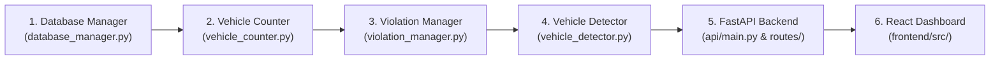

# Document 05: Code Architecture & Comprehensive File-by-File Guide

## 1. Complete Repository Folder Tree

The directory tree below represents the exact structure of the Smart Traffic Vision repository:

```text
c:\Users\ASUS\OneDrive\Desktop\CV_Project_Traffic\
├── api/                                # FastAPI Backend Layer
│   ├── routes/
│   │   ├── health.py                   # GET /api/health & GET /api/diagnostics
│   │   ├── plates.py                   # POST /api/plates/scan
│   │   ├── reports.py                  # GET /api/reports/export (CSV streaming)
│   │   ├── stats.py                    # GET /api/stats/overview
│   │   ├── traffic.py                  # POST /api/traffic/analyze-video & analyze-image
│   │   └── violations.py               # GET /api/violations & PATCH /api/violations/{id}/review
│   ├── dependencies.py                 # Dependency injection (DatabaseManager instance)
│   ├── main.py                         # FastAPI app entrypoint, CORS, static media mounts
│   ├── schemas.py                      # Pydantic data validation models
│   └── utils.py                        # Media URL resolution & file validation helpers
│
├── counting/                           # Vehicle Counting & Spatial Geometry
│   ├── __init__.py
│   └── vehicle_counter.py              # VehicleCounter class, ccw & segment intersection
│
├── database/                           # Relational Persistence
│   ├── __init__.py
│   └── database_manager.py             # DatabaseManager class (SQLite connection pool & migrations)
│
├── detection/                          # Core Vehicle Detection & Processing
│   ├── __init__.py
│   └── vehicle_detector.py             # VehicleDetector class, process_video & process_image
│
├── ocr/                                # License Plate & Character Recognition
│   ├── __init__.py
│   ├── plate_detector.py               # PlateDetector class (YOLO plate localization)
│   └── plate_ocr.py                    # PlateOCR class, EasyOCR integration & text normalization
│
├── violations/                         # Traffic Safety Violations Suite
│   ├── __init__.py
│   └── violation_manager.py            # TrafficViolationManager, HelmetViolationDetector,
│                                       # WrongWayDetector, RedLightDetector, PlateAssociationManager
│
├── data/                               # Media Storage & Databases
│   ├── input/                          # Video/image uploads & test samples (helmet_test.mp4, etc.)
│   ├── output/                         # Processed videos with HUD annotations
│   ├── output/violations/              # Saved high-contrast violation evidence JPEGs
│   └── traffic_violations.db           # SQLite database file
│
├── datasets/                           # Training & Verification Datasets
│   ├── india_traffic/                  # Roboflow vehicle dataset (6 classes, 901 images)
│   ├── india_traffic_detection/        # Duplicate vehicle dataset
│   └── motorcycle_helmet/              # Roboflow helmet dataset (5 classes, 205 images)
│
├── models/                             # Deep Learning Weights
│   ├── helmet_detector.pt              # YOLO11n helmet & motorcycle detector
│   ├── helmet_detector_backup.pt       # Backup weights snapshot
│   ├── plate_detector.pt               # YOLO license plate detector
│   └── vehicle_detector.pt             # YOLO11n 6-class vehicle detector
│
├── frontend/                           # React 19 + TypeScript + Vite Dashboard
│   ├── src/
│   │   ├── api/
│   │   │   ├── client.ts               # Typed fetch wrapper and API method definitions
│   │   │   └── types.ts                # TypeScript interfaces matching Pydantic schemas
│   │   ├── components/
│   │   │   ├── EmptyState.tsx          # Reusable empty data placeholder
│   │   │   ├── ErrorState.tsx          # Reusable error alert with retry button
│   │   │   ├── Header.tsx              # Control room top navbar with real-time clock & pulse
│   │   │   ├── Layout.tsx              # Shell sidebar navigation & main content grid
│   │   │   ├── LoadingState.tsx        # Skeleton loaders & spinner
│   │   │   ├── Modal.tsx               # Evidence inspection modal dialog
│   │   │   └── StatCard.tsx            # KPI metric cards with trends & icons
│   │   ├── pages/
│   │   │   ├── DiagnosticsPage.tsx     # System health, model files, DB connectivity
│   │   │   ├── OverviewPage.tsx        # Command center KPIs & Recharts analytics
│   │   │   ├── PlateScannerPage.tsx    # Single-image plate crop & OCR inspector
│   │   │   ├── RecordsReportsPage.tsx  # Searchable violation ledger & CSV export
│   │   │   ├── SafetyViolationsPage.tsx# Review lifecycle & evidence inspection
│   │   │   └── TrafficAnalysisPage.tsx # Video player with synchronized telemetry HUD
│   │   ├── App.tsx                     # Top-level view router & state holder
│   │   ├── index.css                   # Dark control-room design tokens & CSS rules
│   │   └── main.tsx                    # React DOM root entrypoint
│   ├── package.json
│   └── vite.config.ts
│
├── tests/                              # Automated Pytest Test Suites
│   ├── test_api.py                     # 11 tests: FastAPI endpoint contracts & mock runs
│   ├── test_hardening.py               # 8 tests: COUNT persistence & OCR confidence classification
│   ├── test_helmet_e2e.py              # 19 tests: Helmet unit, DB persistence, API, and dedicated detection
│   ├── test_phase1_pipeline.py         # 8 tests: Counting consistency, HUD, and telemetry
│   └── test_plate_and_violations.py    # 6 tests: Plate association, red-light, and wrong-way
│
├── app.py                              # Legacy Streamlit prototype application (preserved)
├── requirements.txt                    # Python package dependencies
├── yolo11n.pt                          # Base pretrained YOLO11n COCO weights
└── openh264-2.5.0-win64.dll            # Cisco OpenH264 video codec library for Windows
```

---

## 2. Beginner's Study Roadmap: File-by-File Order

If you are preparing for a viva or explaining this codebase from scratch, follow this exact 6-step study sequence:



1. **`database/database_manager.py`**: Understand how SQLite tables are initialized, how duplicate events are filtered, and how structured count summaries are saved.
2. **`counting/vehicle_counter.py`**: Understand how lines are represented, how the Counter-Clockwise (`ccw`) formula tests vector intersections, and how per-frame telemetry is collected.
3. **`violations/violation_manager.py`**: The heart of safety policing. Understand `HelmetViolationDetector` (spatial rider association), `WrongWayDetector` (centroid displacement), and `TrafficViolationManager` (evidence annotation).
4. **`detection/vehicle_detector.py`**: Understand the main loop: reading video frames, invoking YOLO + ByteTrack, and piping detections to the counter and violation manager.
5. **`api/main.py` & `api/routes/`**: Understand how HTTP requests map into calls to the core vision classes and return JSON responses.
6. **`frontend/src/`**: Understand how React components fetch data from the API and render charts, video players, and evidence modals.

---

## 3. Deep Dive into Core Backend Modules

### 1. `database/database_manager.py`
- **Class**: `DatabaseManager`
  - `__init__(db_path="data/traffic_violations.db")`: Initializes connection string and immediately invokes `_init_database()`.
  - `_init_database()`: Creates the `events` table with indexes (`idx_events_track_id`, `idx_events_event_type`, `idx_events_review_status`). Executes a non-destructive migration that adds `count_details` and `total_count` columns to legacy databases and strips dictionaries out of `plate_text`.
  - `insert_event(...) -> int`: Core insertion method with built-in deduplication:
    - If `prevent_duplicates=True` and `track_id` is present, it executes:
      `SELECT id FROM events WHERE event_type = ? AND track_id = ? ORDER BY id DESC LIMIT 1;`
      If a record exists, it skips insertion and returns the existing record ID.
  - `get_events(event_type, review_status, search, limit, offset) -> List[Dict]`: Filterable query method supporting pagination and text search.
  - `update_review_status(event_id, new_status) -> bool`: Updates event review state (`pending`, `approved`, `rejected`). Rejects attempts to review `COUNT` events.

---

### 2. `counting/vehicle_counter.py`
- **Functions**:
  - `ccw(a, b, c) -> float`: Vector cross-product orientation test. Returns positive if points $a \to b \to c$ turn counter-clockwise, negative if clockwise, zero if colinear.
  - `segments_intersect(p1, p2, p3, p4) -> bool`: Checks if vehicle trajectory line segment ($p_1 \to p_2$) intersects virtual counting line ($p_3 \to p_4$).
- **Class**: `VehicleCounter`
  - `__init__(line_start, line_end, target_classes)`: Configures counting line coordinates and class mapping `{0: 'bus', 1: 'car', 2: 'three-wheeler', 3: 'truck', 4: 'two-wheeler', 5: 'van'}`.
  - `update(boxes, frame_idx, timestamp_s)`:
    - Extracts `track_id` and centroid $(c_x, c_y)$ for each vehicle.
    - If `track_id` was seen in previous frame, tests `segments_intersect(prev_center, curr_center, line_start, line_end)`.
    - If intersection occurs and `track_id not in self.counted_ids`: increments `class_counts[class_name]` and adds `track_id` to `counted_ids`.
    - Appends a snapshot dictionary to `self.telemetry` recording visible vs. cumulative counts.
  - `draw(frame) -> frame`: Renders the virtual counting line and modern semi-transparent HUD banner displaying totals and category breakdowns.

---

### 3. `violations/violation_manager.py`
- **Class**: `HelmetViolationDetector`
  - `__init__(model_path, conf_thresh=0.20, cooldown_seconds=10.0)`: Loads `models/helmet_detector.pt`.
  - `detect_frame_violations(frame, current_time, tracked_boxes, target_classes) -> List[Dict]`:
    - Evaluates full frame with `helmet_detector.pt`.
    - Groups detections into `motorcycles`, `helmets`, and `nohelmets`.
    - For each motorcycle, calculates rider search zone: $[x_1 - 0.15w, y_1 - 0.25h, x_2 + 0.15w, y_1 + 0.65h]$.
    - Finds heads inside this zone. Resolves multi-rider scenes independently. If `Helmet` and `nohelmet` coincide on the same head, confirms violation only if `nohelmet_conf > helmet_conf`.
    - Maintains an internal spatial tracker (`_active_tracks`) across consecutive frames if ByteTrack missed the bike, assigning stable pseudo-track IDs (`#9001`, `#9002`...).
  - `check_motorcycle(frame, bbox, track_id, current_time)`: Preserved single-crop evaluation method for backward compatibility.
- **Class**: `WrongWayDetector`
  - `update(track_id, center, current_time) -> Optional[Dict]`:
    - Tracks centroid displacement across a rolling buffer of 10 positions.
    - Checks if net displacement exceeds 25 pixels and aligns opposite to `expected_direction` (e.g. traveling UP in a DOWN corridor).
- **Class**: `TrafficViolationManager`
  - Orchestrator class combining `HelmetViolationDetector`, `WrongWayDetector`, `RedLightDetector`, and `PlateAssociationManager`.
  - `process_frame(frame, tracked_boxes, target_classes, frame_idx, timestamp_s) -> List[Dict]`: Executes active rules, saves annotated evidence JPEGs to `data/output/violations/`, and inserts records into `DatabaseManager`.
  - `_create_annotated_evidence(...) -> np.ndarray`: Draws high-contrast top violation banners, label tags, orange head boxes, and bottom timestamp audit footers.

---

### 4. `detection/vehicle_detector.py`
- **Class**: `VehicleDetector`
  - `__init__(model_path="models/vehicle_detector.pt", conf_threshold=0.35)`: Loads custom YOLO model.
  - `process_video(input_path, output_path, enable_tracking=True, tracker="bytetrack.yaml", counter, violation_manager, max_frames, frame_skip)`:
    - Master video pipeline loop.
    - Uses OpenCV `VideoCapture` to read frames.
    - Runs YOLO `.track(persist=True, tracker=tracker)` or `.predict()`.
    - Calls `counter.update(boxes)` and `violation_manager.process_frame(frame, boxes)`.
    - Writes annotated frames via OpenCV `VideoWriter` using `avc1` codec.

---

### 5. `ocr/plate_ocr.py` & `ocr/plate_detector.py`
- **Class**: `PlateDetector` (`ocr/plate_detector.py`):
  - Runs `models/plate_detector.pt` to predict bounding boxes $[x_1, y_1, x_2, y_2]$ of license plates.
- **Module**: `ocr/plate_ocr.py`:
  - `normalize_plate_text(raw_text) -> str`: Normalizes whitespace, converts to uppercase, and strips bracket/border noise (`[]{}()`).
  - `validate_plate_output(raw_text, confidence, min_confidence_threshold=0.50) -> Dict`: Audits text format against Indian regex (`^[A-Z]{2}[0-9]{1,2}[A-Z]{0,3}[0-9]{4}$`), tags `is_low_confidence = True` if score $< 0.50$, and classifies status as `high`, `medium`, `low`, or `unreadable`.
  - `PlateOCR.read_plate_detailed(plate_crop) -> Dict`: Feeds image array to EasyOCR reader and returns structured audit dictionary.

---

## 4. Deep Dive into FastAPI Backend (`api/`)

### Route Controllers & Endpoints
1. **`api/routes/health.py`**:
   - `GET /api/health`: Returns API heartbeat, application name, version, and server timestamp.
   - `GET /api/diagnostics`: Verifies physical existence of model weights on disk, SQLite write access, required output directories, and OpenH264 DLL status.
2. **`api/routes/stats.py`**:
   - `GET /api/stats/overview`: Computes total vehicles counted, total safety violations (strictly excluding `COUNT` events), category breakdowns, and the 5 most recent events.
3. **`api/routes/traffic.py`**:
   - `POST /api/traffic/analyze-video`: Accepts multipart video upload, runs `process_video()`, commits a `COUNT` event with structured counts, and returns processed video URL and per-frame telemetry.
   - `POST /api/traffic/analyze-image`: Runs single-image vehicle detection and returns annotated image URL with bounding box list.
4. **`api/routes/plates.py`**:
   - `POST /api/plates/scan`: Detects plates using `plate_detector.pt`, crops each plate, extracts text via `plate_ocr.py`, saves crops, and returns detected plates with confidence statuses.
5. **`api/routes/violations.py`**:
   - `GET /api/violations`: Searchable, filterable, paginated event list. Defaults to excluding `COUNT` events unless `include_counts=true`.
   - `PATCH /api/violations/{id}/review`: Updates review status (`pending` &rarr; `approved` / `rejected`). Rejects modifications to `COUNT` records with HTTP 400.
6. **`api/routes/reports.py`**:
   - `GET /api/reports/export`: Queries events from SQLite, structures data via Pandas, and returns a downloadable streaming `text/csv` response.

---

## 5. Deep Dive into Frontend React Dashboard (`frontend/src/`)

### Pages
- **`OverviewPage.tsx`**: Renders 4 primary KPI cards (Total Vehicles, Active Violations, Pending Reviews, Camera Diagnostics) and two Recharts visualizations (Vehicle Category Breakdown Bar Chart and Violations by Type Donut Chart).
- **`TrafficAnalysisPage.tsx`**: Split-screen interface featuring video upload controls, parameter configuration (confidence threshold slider, counting line position, signal state selector), HTML5 video player, and synchronized telemetry graphs showing vehicle counts at current playback timestamp.
- **`SafetyViolationsPage.tsx`**: Filterable table of all detected infractions. Clicking any row opens `Modal.tsx` showing the full-resolution annotated evidence snapshot, violation reason, plate tag, and review buttons (`Approve`, `Reject`).
- **`PlateScannerPage.tsx`**: ANPR testing view allowing single-image uploads, displaying localized plate crops, OCR string, confidence badge (`high`, `medium`, `low`), and raw unedited text.
- **`RecordsReportsPage.tsx`**: Complete historical database ledger with search by plate or vehicle type, date filtering, and direct "Export to CSV" action.
- **`DiagnosticsPage.tsx`**: Live health dashboard displaying backend uptime, database table row counts, model weight file statuses, and environment information.

---

## 6. Conceptual Viva Reference (Hinglish & English)

### Hinglish Concept Explanation
> *"Codebase ko samajhne ka sabse aasan tareeka ye hai:*
> 1. *Data Layer: `database/database_manager.py` me SQLite connection aur queries hain jo duplicate events rokne ka kaam karti hain.*
> 2. *Vision Core: `detection/vehicle_detector.py` video ko frame-by-frame padhta hai, ByteTrack se tracking ID deta hai, aur do jagah data bhejta hai:*
>    - *`counting/vehicle_counter.py`: Gaadiyon ko line cross karne pe count karta hai.*
>    - *`violations/violation_manager.py`: Helmet, Wrong-way aur Red-light check karta hai.*
> 3. *OCR Core: `ocr/plate_ocr.py` EasyOCR use karke plate read karta hai aur `validate_plate_output()` se low-confidence results ko flag karta hai.*
> 4. *API Layer: `api/main.py` FastAPI app banata hai aur `api/routes/` me alag-alag endpoints define hain.*
> 5. *Frontend: `frontend/src/` me React 19 aur TypeScript ka dashboard hai jo API se baat karta hai."*

### Formal English Viva Answers (For Speaking Aloud)

**Q1: How is your codebase structured to maintain separation of concerns?**
> *"Our project strictly decouples the vision pipeline, persistence layer, API service, and frontend. Core computer vision logic resides in dedicated packages: `detection/` for vehicle detection, `counting/` for line-crossing arithmetic, `violations/` for safety enforcement, and `ocr/` for license plate extraction. The `database/` layer handles SQLite persistence. FastAPI under `api/` wraps these modules into stateless REST endpoints, while our React dashboard in `frontend/` acts purely as an interface consumer."*

**Q2: What is the call flow when a user analyzes a video?**
> *"When a video is submitted, `api/routes/traffic.py` receives the multipart file and passes it to `VehicleDetector.process_video()`. For every frame, YOLO detects vehicles, ByteTrack assigns tracking IDs, and `VehicleCounter.update()` performs vector intersection testing. Concurrently, `TrafficViolationManager.process_frame()` runs dedicated helmet detection and trajectory checks. If violations occur, evidence frames are written to disk and SQLite events are inserted. Finally, an overall COUNT event is logged, and the endpoint returns the processed video URL, counts, and per-frame telemetry to the React player."*
