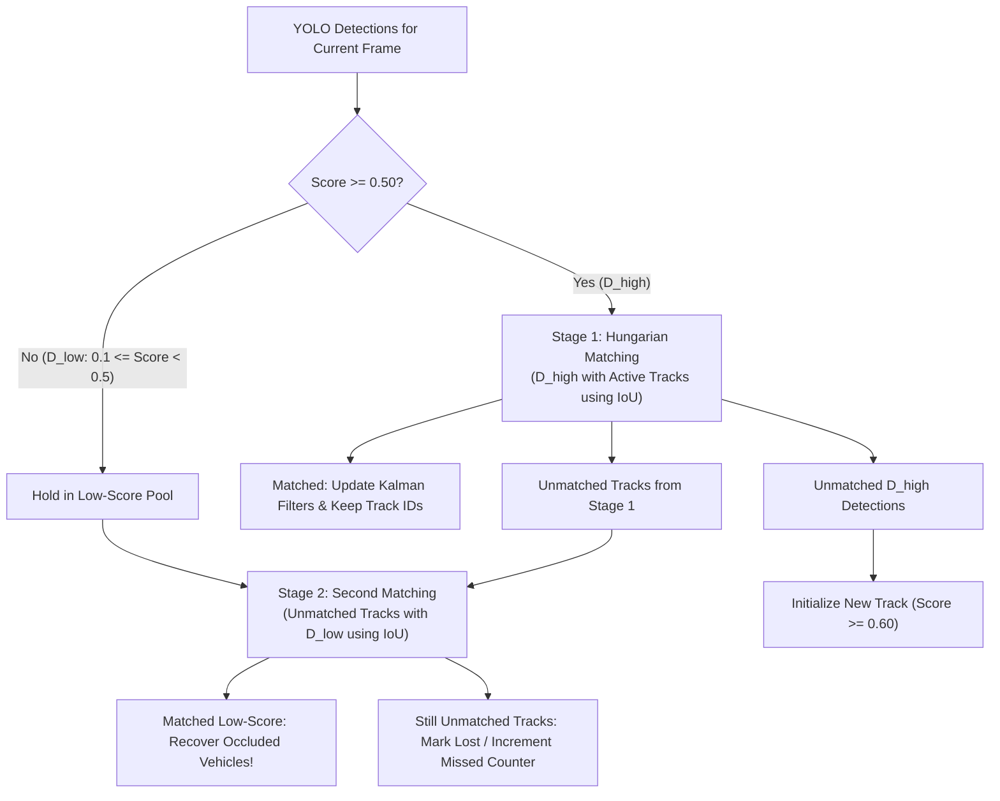
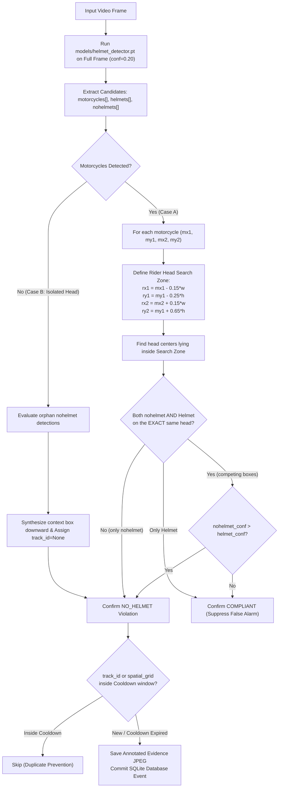

# Document 06: Detection, Tracking & Traffic Safety Violation Mechanics

## 1. Deep Dive: ByteTrack Multi-Object Tracking (MOT)

### The Core Problem in Traditional Trackers
In high-density traffic surveillance, objects frequently experience motion blur, temporary occlusions behind larger vehicles (e.g. a motorcycle occluded behind a bus), or low-contrast lighting.
- Traditional trackers (such as SORT or early DeepSORT) apply a high detection threshold (e.g. $> 0.50$ or $> 0.60$) and **immediately discard all low-confidence bounding boxes**.
- **The Consequence**: As soon as a motorcycle is partially occluded, its detection score drops to $0.30$. The tracker drops the box, deletes the track track ID, and creates a brand-new identity when the vehicle re-emerges, causing catastrophic **identity switches (ID switches)** and broken trajectories.

### How ByteTrack Solves This: Two-Stage Association
ByteTrack revolutionizes tracking by using **almost every detection box**, dividing candidate detections into high-score and low-score pools:



#### ByteTrack Mathematical Formulation
1. **Kalman Filter Motion Prediction**:
   The state of a tracked vehicle bounding box at frame $t$ is modeled as an 8-dimensional vector:
   $$\mathbf{x} = [x_c, y_c, a, h, \dot{x}_c, \dot{y}_c, \dot{a}, \dot{h}]^T$$
   where $(x_c, y_c)$ is the box center, $a = w/h$ is the aspect ratio, $h$ is height, and $(\dot{x}_c, \dot{y}_c, \dot{a}, \dot{h})$ represent their respective velocities.
   The Kalman filter predicts the vehicle's state in the next frame prior to detection matching:
   $$\mathbf{x}_{t|t-1} = \mathbf{F} \mathbf{x}_{t-1}, \quad \mathbf{P}_{t|t-1} = \mathbf{F} \mathbf{P}_{t-1} \mathbf{F}^T + \mathbf{Q}$$
2. **IoU Distance Cost Matrix**:
   The similarity matrix between predicted Kalman track boxes $\mathbf{T}$ and detected boxes $\mathbf{D}$ is computed as:
   $$\mathbf{C}_{i,j} = 1 - \text{IoU}(\mathbf{T}_i, \mathbf{D}_j)$$
3. **Hungarian Algorithm**:
   Solves the optimal bipartite assignment problem minimizing total cost $\sum \mathbf{C}_{i,j}$ in polynomial time $O(N^3)$.

---

## 2. Virtual-Line Vehicle Counting Geometry

In `counting/vehicle_counter.py`, counting is performed by calculating the spatial intersection between a vehicle's motion vector across consecutive frames and a static virtual counting line.

```
                  Counting Line (p3 -> p4)
                  p3 ------------------------ p4
                             /
                            /  Vehicle Trajectory Segment (p1 -> p2)
                           /
                         p2 (Current Frame Centroid)
                         
                         p1 (Previous Frame Centroid)
```

### The Counter-Clockwise (`ccw`) Orientation Formula
To determine whether two line segments intersect without solving expensive floating-point linear equation systems, the system computes the signed orientation of three points:
```python
def ccw(a, b, c):
    """
    Returns signed cross-product magnitude:
    > 0: Counter-Clockwise turn
    < 0: Clockwise turn
    = 0: Colinear points
    """
    return (b[0] - a[0]) * (c[1] - a[1]) - (b[1] - a[1]) * (c[0] - a[0])
```

### Line Segment Intersection (`segments_intersect`)
Two segments $p_1 \to p_2$ (trajectory) and $p_3 \to p_4$ (counting line) intersect if and only if points $p_1$ and $p_2$ lie on opposite sides of line $p_3 \to p_4$, AND points $p_3$ and $p_4$ lie on opposite sides of line $p_1 \to p_2$:
$$\left(\text{ccw}(p_3, p_4, p_1) \times \text{ccw}(p_3, p_4, p_2) < 0\right) \quad \text{AND} \quad \left(\text{ccw}(p_1, p_2, p_3) \times \text{ccw}(p_1, p_2, p_4) < 0\right)$$
- When this condition evaluates to `True` for a `track_id` that is not in `counted_ids`, the vehicle is counted, `class_counts[class_name]` increments by 1, and the ID is added to `self.counted_ids` to permanently prevent double-counting.

---

## 3. Dedicated Spatial Helmet-First Detection Pipeline

### The Bottleneck in Legacy Architectures
Standard traffic systems implement helmet detection as a strict linear dependency:
$$\text{Frame} \longrightarrow \text{Vehicle Detector} \xrightarrow{\text{If Two-Wheeler}} \text{Crop Top 45\%} \longrightarrow \text{Helmet Classifier}$$
If the vehicle detector misses the motorcycle (due to overhead training bias, unusual angles, or occlusion), **zero helmet checks ever execute**.

### Our Solution: Self-Bootstrapped Spatial Helmet Detection
Our helmet model (`models/helmet_detector.pt`) was trained on 5 classes: `{0: Helmet, 1: fd, 2: motorcycle, 3: nohelmet, 4: platenumber}`.
Because the helmet model natively detects `motorcycle` (class 2) as well as head classes (`Helmet` and `nohelmet`), it can **self-bootstrap motorcycle detection across the entire frame**:



### Multi-Rider Spatial Disambiguation (Solving Co-Detection Suppression)
Consider frame `28_jpg.rf.c44dd4fac8af2108417db664f4f5dd6b.jpg` from our dataset:
- **Motorcycle 1** ($x=323..739$): Rider wears **no helmet** (`nohelmet` conf 0.24).
- **Motorcycle 2** ($x=762..1199$): Rider wears a **helmet** (`Helmet` conf 0.29).

#### The Old Flawed Logic
`if has_nohelmet and not has_helmet:`
Because `has_helmet` was `True` anywhere in the frame/crop, the genuine violation on Motorcycle 1 was **completely suppressed**!

#### Our Spatial Logic
Each motorcycle defines an independent rider search zone based on its own bounding coordinates.
1. The unhelmeted head at $(569, 111)$ falls inside Motorcycle 1's search zone &rarr; Evaluated independently &rarr; **NO_HELMET violation confirmed**.
2. The helmeted head at $(1044, 275)$ falls inside Motorcycle 2's search zone &rarr; Evaluated independently &rarr; **Compliant confirmed**.
3. Neither rider affects or suppresses the other!

---

## 4. Wrong-Way Movement Detection

In `violations/violation_manager.py`, `WrongWayDetector` detects vehicles traveling counter to the authorized corridor flow:

```python
# Rolling centroid displacement test
net_dx = last_center[0] - first_center[0]
net_dy = last_center[1] - first_center[1]
dist = sqrt(net_dx**2 + net_dy**2)

if dist >= min_distance_threshold:  # 25 pixels
    # Check against expected_direction ('down', 'up', 'left', 'right')
    if expected_direction == "down" and net_dy < -15:
        # Traveling UP in a DOWN lane -> VIOLATION!
```
- **Rejection of Stationary Vehicles**: If net displacement $< 25$ pixels, the vehicle is deemed parked or stuck in traffic; no violation is triggered.
- **Trajectory Consistency**: Requires at least 4 consistent centroid history points before flagging.

---

## 5. Virtual Red-Light Policy

The virtual red-light module operates under a strict safety gate:
1. **Signal State Gating**:
   In `RedLightDetector.check_crossing()`:
   If `self.signal_state != "RED"`, the function immediately returns `None`. **Violations are strictly impossible when the virtual signal is GREEN or YELLOW.**
2. **Stop-Line Crossing**:
   When `signal_state == "RED"`, any tracked vehicle whose centroid crosses from the approach side to the intersection side across the virtual stop-line triggers a `RED_LIGHT` violation event.

---

## 6. License Plate Association & Evidence Generation

### 1. Spatial Plate Association
In `PlateAssociationManager.process_frame()`:
- License plate bounding boxes detected by `plate_detector.pt` are paired with tracked vehicles.
- A plate is associated with vehicle $T_i$ if the plate center lies geometrically inside the vehicle's bounding box, or if their mutual overlap exceeds a 60% plausibility threshold.
- The plate crop is processed by `PlateOCR.read_plate_detailed()`, and the normalized plate text is attached to the vehicle's `track_id`.

### 2. Evidence Frame Annotation
When a violation occurs, `_create_annotated_evidence()` renders a tamper-evident JPEG:
1. **Red Vehicle Box**: Thick red rectangle surrounding the offending vehicle.
2. **Orange Head Box**: Distinct orange/amber rectangle enclosing the rider's bare head with a `NO HELMET` label.
3. **Top Header Banner**: Dark banner displaying event type, vehicle ID, class, and confidence percentage.
4. **License Plate Tag**: Embedded plate text (or `UNKNOWN` if not readable).
5. **Bottom Audit Footer**: Timestamp, unique event identifier, and exact violation reason string.

---

## 7. Pseudocode of Master Video Frame Loop

```python
for frame_idx, frame in enumerate(video_stream):
    timestamp_s = frame_idx / fps
    
    # 1. Primary Vehicle Detection & ByteTrack
    tracked_boxes = vehicle_detector.track(frame, persist=True)
    
    # 2. Virtual Line Counting
    counter.update(tracked_boxes, frame_idx, timestamp_s)
    
    # 3. Dedicated Helmet-First Scan (Runs even if tracked_boxes is empty!)
    if enable_helmet:
        helmet_violations = helmet_detector.detect_frame_violations(frame, timestamp_s, tracked_boxes)
        for viol in helmet_violations:
            evidence_path = save_annotated_evidence(frame, viol)
            db.insert_event("NO_HELMET", viol.track_id, "motorcycle", viol.conf, evidence_path)
            
    # 4. Trajectory-Dependent Checks (Wrong-Way & Stop-Line)
    for box in tracked_boxes:
        if enable_wrong_way:
            wrong_way_detector.update(box.track_id, box.center, timestamp_s)
        if enable_red_light and signal_state == "RED":
            red_light_detector.check_crossing(box.track_id, box.center, timestamp_s)
            
    # 5. Composite HUD & Stream Output
    annotated_frame = counter.draw(frame)
    video_writer.write(annotated_frame)
```

---

## 8. Conceptual Viva Reference (Hinglish & English)

### Hinglish Concept Explanation
> *"Tracking aur violation logic ko samjhein:*
> 1. *ByteTrack ka magic ye hai ki wo low-confidence boxes (jaise 0.2 ya 0.3) ko fekta nahi hai. Agar koi gaadi thodi der ke liye kisi bus ke piche chhip jaye, toh ByteTrack use doosre stage me IoU matching se recover kar leta hai.*
> 2. *Counting Line: Hum line crossing ke liye CCW (Counter-Clockwise) cross product formula use karte hain. Agar gaadi ka trajectory vector counting line ko kaat-ta hai, toh count 1 badh jata hai aur track ID ko memory me lock kar dete hain taaki dubara count na ho.*
> 3. *Helmet Detection: Pehle vehicle detector bike miss kar deta tha toh helmet check chalta hi nahi tha. Humne ise fix kiya: ab helmet model direct pure frame me motorcycle aur bare head ko spatially match karta hai. Agar ek bike pe helmet wala hai aur doosri pe bina helmet wala, toh dono independent check hote hain — koi false suppression nahi hoti."*

### Formal English Viva Answers (For Speaking Aloud)

**Q1: How does ByteTrack differ from DeepSORT, and why is it superior for traffic surveillance?**
> *"DeepSORT discards low-confidence detections and relies on visual appearance embeddings, which makes it computationally heavy and prone to identity switches when vehicles are partially occluded. ByteTrack retains both high- and low-score detection pools, associating low-score boxes in a second matching stage via Kalman filter predictions and IoU matching. This recovers occluded vehicles without adding deep visual feature computation overhead."*

**Q2: How does the virtual counting line prevent double-counting vehicles?**
> *"Vehicle counting is governed by a vector intersection algorithm using the Counter-Clockwise (`ccw`) orientation formula between the vehicle's centroid trajectory segment and the counting line segment. Once an intersection is confirmed, the vehicle's unique `track_id` is appended to an in-memory set (`self.counted_ids`). Subsequent frames check this set in $O(1)$ time, guaranteeing that a vehicle crossing the line is counted exactly once."*

**Q3: How does your helmet detector handle multiple riders in the same frame?**
> *"Rather than classifying the frame globally, our `detect_frame_violations` method establishes a localized rider search bounding box around each detected motorcycle. Head detections—both `Helmet` and `nohelmet`—are spatially associated with their respective motorcycle. In scenes with multiple riders, each rider is evaluated independently within their motorcycle's coordinates, ensuring that a compliant rider on one motorcycle never suppresses a genuine safety violation on another."*
