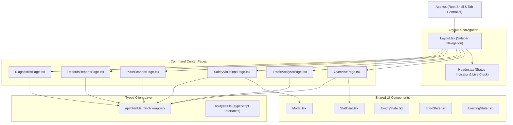

# Document 07: Backend, Database Schema & Frontend Integration

## 1. FastAPI REST Architecture & Endpoint Specifications

The backend service is built using **FastAPI** (`api/main.py`), utilizing an asynchronous ASGI server architecture powered by **Uvicorn**.

### API Architecture Highlights
- **Stateless REST Design**: The backend maintains no in-memory session state; every request is validated independently against Pydantic schemas.
- **Dependency Injection**: The database manager singleton is injected into route handlers using FastAPI's `Depends(get_db)` pattern (`api/dependencies.py`).
- **Static Media Mounts**: Static directories are exposed using `Starlette.staticfiles.StaticFiles`:
  - `/media/violations` &rarr; mapped to `data/output/violations/` (evidence snapshots)
  - `/media/output` &rarr; mapped to `data/output/` (processed video streams)
- **CORS Configuration**: Configured via `CORSMiddleware` to permit cross-origin requests from the Vite frontend development server (`http://localhost:5173` and `http://127.0.0.1:5173`).

---

### Complete Endpoint Reference

| HTTP Method | Path | Request Body / Query Params | Response Schema | Description |
| :--- | :--- | :--- | :--- | :--- |
| **`GET`** | `/api/health` | None | `HealthResponse` | Backend liveness check, version, and server timestamp |
| **`GET`** | `/api/diagnostics` | None | `DiagnosticsResponse` | Hardware diagnostics, model weight file checks, DB status |
| **`GET`** | `/api/stats/overview` | None | `OverviewStatsResponse` | Aggregate vehicle counts, safety violation totals, category breakdown |
| **`POST`** | `/api/traffic/analyze-video` | `multipart/form-data`: `file`, `conf_threshold`, `enable_helmet`, etc. | `AnalyzeVideoResponse` | Runs full CV pipeline on video, commits COUNT event, returns telemetry |
| **`POST`** | `/api/traffic/analyze-image` | `multipart/form-data`: `file`, `conf_threshold` | `AnalyzeImageResponse` | Detects vehicles in static image, returns annotated image URL & boxes |
| **`POST`** | `/api/plates/scan` | `multipart/form-data`: `file`, `conf_threshold` | `PlateScanResponse` | Localizes plates, extracts text via EasyOCR, audits confidence |
| **`GET`** | `/api/violations` | `event_type`, `review_status`, `search`, `page`, `limit`, `include_counts` | `ViolationsListResponse` | Paginated, filterable event ledger (excludes `COUNT` by default) |
| **`PATCH`** | `/api/violations/{id}/review` | JSON: `{"status": "approved" \| "rejected" \| "pending"}` | `ReviewStatusResponse` | Updates review status of safety violations (rejects COUNT records) |
| **`GET`** | `/api/reports/export` | `event_type`, `review_status` | `text/csv` (Stream) | Streams SQLite event records as a downloadable CSV file |

---

## 2. Relational Database Schema & Migrations (`data/traffic_violations.db`)

The database layer is managed through `database/database_manager.py` using SQLite3.

### Table Schema: `events`
```sql
CREATE TABLE IF NOT EXISTS events (
    id INTEGER PRIMARY KEY AUTOINCREMENT,
    timestamp TEXT NOT NULL,
    track_id INTEGER,
    vehicle_class TEXT,
    event_type TEXT NOT NULL,
    confidence REAL,
    plate_text TEXT,
    evidence_path TEXT,
    review_status TEXT DEFAULT 'pending',
    count_details TEXT,
    total_count INTEGER
);

CREATE INDEX IF NOT EXISTS idx_events_track_id ON events (track_id);
CREATE INDEX IF NOT EXISTS idx_events_event_type ON events (event_type);
CREATE INDEX IF NOT EXISTS idx_events_review_status ON events (review_status);
```

### Column Descriptions & Business Rules
1. **`id`**: Unique primary key integer auto-incremented by SQLite.
2. **`timestamp`**: ISO format string `YYYY-MM-DD HH:MM:SS` representing when the event occurred.
3. **`track_id`**: Integer tracking identity from ByteTrack or pseudo-tracker. Can be `NULL` for isolated, untracked rider detections.
4. **`vehicle_class`**: Detected category string (`car`, `bus`, `two-wheeler`, `motorcycle`, etc.) or `'Traffic Stream'` for video count summaries.
5. **`event_type`**: Event classification string:
   - `'NO_HELMET'`: Unhelmeted rider detected.
   - `'WRONG_WAY'`: Vehicle moving opposite to authorized direction.
   - `'RED_LIGHT'`: Vehicle crossed stop-line while signal state was RED.
   - `'COUNT'`: Session-level vehicle line crossing summary record.
   - `'PLATE_READ'`: Standalone license plate scan event.
6. **`confidence`**: Float value $[0.0, 1.0]$ representing model detection score.
7. **`plate_text`**: Extracted alphanumeric license plate string (or `UNKNOWN` / `NULL`). **Rule**: Never used for storing count dictionaries.
8. **`evidence_path`**: Absolute or relative disk path to the saved annotated JPEG image or processed video MP4.
9. **`review_status`**: Human audit lifecycle status: `'pending'`, `'approved'`, or `'rejected'`.
10. **`count_details`**: JSON string storing structured category totals for `COUNT` events (e.g. `'{"car": 14, "bus": 2, "truck": 1}'`). `NULL` for safety violations.
11. **`total_count`**: Integer total vehicles counted across virtual line for `COUNT` events. `NULL` for safety violations.

### Non-Destructive Schema Migration Logic
In `DatabaseManager._init_database()`:
- Queries `PRAGMA table_info(events);`.
- If `count_details` or `total_count` columns are missing from a legacy database file, dynamically issues:
  `ALTER TABLE events ADD COLUMN count_details TEXT;`
  `ALTER TABLE events ADD COLUMN total_count INTEGER;`
- Executes an idempotent data repair query: if legacy records stored count dictionaries in `plate_text`, it extracts the dictionary into `count_details`, parses the sum into `total_count`, sets `vehicle_class = 'Traffic Stream'`, and clears `plate_text = NULL`.

---

## 3. Frontend Architecture (`frontend/src/`)

The frontend is a single-page application (SPA) built with **React 19**, **TypeScript**, and **Vite**.



### Component Breakdown
1. **`Header.tsx`**: Displays the active command room title, a pulsing green live connection badge (`SYSTEM ONLINE`), and a real-time ticking digital clock (`HH:MM:SS`).
2. **`StatCard.tsx`**: Reusable metric card displaying icon, title, large quantitative value, trend subtitle, and optional accent color.
3. **`Modal.tsx`**: Accessible popup dialog rendering full-screen evidence snapshots with backdrop blur, keyboard ESC dismissal, and header title.
4. **`LoadingState.tsx` / `ErrorState.tsx` / `EmptyState.tsx`**: Provides consistent visual states during asynchronous API fetching.

### Client-Server Communication & Media Handling
In `frontend/src/api/client.ts`:
- The helper `getFullMediaUrl(path)` converts backend relative media paths (e.g. `/media/violations/helmet_viol_123.jpg`) into fully qualified URLs reachable by the browser.
- In development, Vite's reverse proxy (`vite.config.ts`) routes all `/api` and `/media` requests to `http://127.0.0.1:8000`, eliminating CORS preflight overhead during local testing.

### Dashboard Refresh & Review Behavior
- When an operator approves or rejects an infraction in `SafetyViolationsPage.tsx`, the frontend executes a `PATCH /api/violations/{id}/review` request.
- Upon receiving `HTTP 200 OK`, the client performs an **optimistic state update**, immediately updating the local row status badge to green (`Approved`) or red (`Rejected`) without requiring a jarring full-page browser refresh.

---

## 4. Conceptual Viva Reference (Hinglish & English)

### Hinglish Concept Explanation
> *"Backend aur Frontend ka connection samjhein:*
> 1. *FastAPI Backend: Humne FastAPI use kiya hai jisme Pydantic schemas se data type-safe rehta hai. `api/main.py` me static routes mounted hain jisse browser evidence photos (`/media/violations/`) direct dekh sakta hai.*
> 2. *Database: SQLite use ho rahi hai. `events` table me violations aur counting store hoti hai. Humne ensure kiya hai ki COUNT records ko kabhi safety violation ke count me na joda jaye aur na hi unhe review kiya ja sake.*
> 3. *React Frontend: React 19 aur TypeScript me modern dark control-center UI hai. Video player ke niche synchronized telemetry graphs chalte hain jo batate hain ki video ke kis second pe kitni gaadiyan thi. Jab operator violation ko approve/reject karta hai, toh bina page reload kiye state turant update hoti hai."*

### Formal English Viva Answers (For Speaking Aloud)

**Q1: How does your database distinguish between traffic counts and safety violations?**
> *"In our SQLite schema, all system events reside in the `events` table distinguished by the `event_type` column. Safety violations use types like `'NO_HELMET'`, `'WRONG_WAY'`, and `'RED_LIGHT'`. Video counting sessions use the `'COUNT'` event type, which stores structured category summaries in the `count_details` JSON column and total vehicles in `total_count`. Our API queries strictly filter `WHERE event_type != 'COUNT'` when computing violation metrics, ensuring counting summaries never distort safety figures."*

**Q2: How does the React dashboard handle asynchronous API communication and media display?**
> *"The React dashboard utilizes a centralized typed API client in `frontend/src/api/client.ts` using the browser `fetch` API. Responses are strongly typed against TypeScript interfaces matching backend Pydantic schemas. Media files—such as processed video streams and annotated evidence JPEGs—are served via FastAPI's static media mounts and resolved through `getFullMediaUrl()`. Vite's development proxy transparently routes requests to port 8000."*

**Q3: What happens when an operator updates the review status of a violation?**
> *"The frontend dispatches a `PATCH /api/violations/{id}/review` request with the new status (`'approved'` or `'rejected'`). The backend validates the ID, confirms the event is not an immutable `COUNT` record, and updates the `review_status` column in SQLite. Upon receiving confirmation, the React component performs an optimistic state update to immediately refresh the UI badge without a full page reload."*
