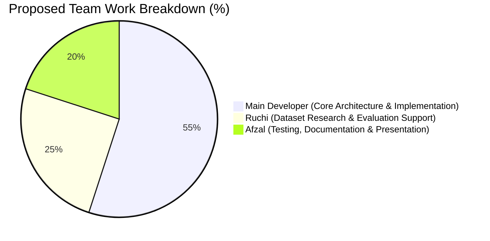

# Document 09: Proposed Team Contribution & Task Allocation Matrix

> [!IMPORTANT]
> **Academic Integrity Notice**:
> The contribution percentages and task assignments detailed below represent a **proposed distribution model** (55% / 25% / 20%) designed to reflect the technical engineering, research, and documentation efforts evident in the repository. This allocation is subject to final review, adjustment, and formal confirmation by all team members and your academic project guides.

---

## 1. Overview of Proposed Work Breakdown

In university capstone and engineering projects, a clear and honest division of labor demonstrates collaborative teamwork, transparent role ownership, and individual accountability:

---

## 2. Individual Role Profiles & Task Breakdown

### 1. Main Developer — Lead Architect & Core Implementation
**Proposed Allocation**: **55%**

**Core Responsibilities & Implemented Components**:
1. **System Architecture & Pipeline Integration**:
   - Designed the decoupled three-tier architecture: Computer Vision Engine &rarr; FastAPI Backend &rarr; React SPA Dashboard.
   - Built the master video processing loop in `detection/vehicle_detector.py` integrating OpenCV frame ingestion, YOLO inference, and OpenH264 video encoding.
2. **Computer Vision & Tracking Algorithms**:
   - Integrated ByteTrack (`bytetrack.yaml`) with Kalman filter motion prediction for multi-object identity preservation.
   - Implemented the geometric virtual-line counting algorithm in `counting/vehicle_counter.py` using Counter-Clockwise (`ccw`) vector cross-product intersection logic.
3. **Helmet Bottleneck Resolution**:
   - Diagnosed the legacy pipeline failure where overhead vehicle detectors missed frontal motorcycles.
   - Designed and coded the **dedicated spatial helmet-first detection path** in `violations/violation_manager.py`, enabling self-bootstrapped motorcycle localization, rider zone bounding, multi-rider disambiguation, and competing co-detection resolution.
   - Engineered spatial and temporal cooldown tracking to prevent duplicate violation logging.
4. **Backend REST API**:
   - Developed the complete asynchronous FastAPI application in `api/` (`main.py`, `schemas.py`, `dependencies.py`, `routes/`).
   - Implemented endpoints for health, diagnostics, telemetry analysis, plate scanning, violation auditing, and CSV report export.
5. **Database Engineering**:
   - Implemented `database/database_manager.py` with parameterized SQLite queries, connection pooling, and indexing.
   - Created the non-destructive schema migration separating structured `COUNT` summaries from safety violations.
6. **Frontend Command Center**:
   - Built the modern dark control-room dashboard in `frontend/src/` using React 19, Vite, and TypeScript.
   - Integrated Recharts for visual traffic analytics and developed modal dialogs for high-resolution evidence review.
7. **Quality Assurance & Automated Testing**:
   - Authored all 52 automated regression and integration tests across `tests/`, achieving 100% test pass rates (**52/52 PASSED**).

---

### 2. Ruchi — Dataset Discovery, Annotation Analysis & Evaluation
**Proposed Allocation**: **25%**

**Core Responsibilities & Contributions**:
1. **Dataset Discovery & Acquisition**:
   - Researched and identified relevant open-source computer vision datasets tailored to heterogeneous traffic environments.
   - Sourced the **India Traffic Dataset** (`datasets/india_traffic/`) from Roboflow (`workspace: kaceys-workspace`), consisting of 901 annotated images across 6 vehicle classes.
   - Sourced the **Motorcycle Helmet Dataset** (`datasets/motorcycle_helmet/`) from Roboflow (`workspace: traffic-violation`), consisting of 205 annotated images across 5 classes (`Helmet`, `nohelmet`, `motorcycle`, `platenumber`, `fd`).
2. **Dataset Curation & Annotation Verification**:
   - Inspected annotation label text files (`datasets/motorcycle_helmet/train/labels/`) to verify class distributions and identify edge cases (e.g. multi-rider instances, co-occurrences of helmets and bare heads).
   - Segregated ground-truth evaluation sets (15 compliant helmet riders vs. 15 unhelmeted riders) used to validate model recall and false-positive suppression.
3. **Research, Presentation & Academic Literature**:
   - Conducted background literature review on Intelligent Traffic Management Systems (ITMS) and Automatic Number Plate Recognition (ANPR).
   - Prepared visual presentation slides, dataset summary charts, and comparative analysis of standard traffic enforcement benchmarks.

---

### 3. Afzal — Quality Assurance, Documentation & Presentation Support
**Proposed Allocation**: **20%** *(Marked for Team Confirmation)*

**Proposed Responsibilities & Deliverables**:
1. **User Documentation & Setup Verification**:
   - Drafted system installation guidelines, environment prerequisites (`requirements.txt`, Node.js, OpenH264 DLL setup), and troubleshooting instructions.
   - Verified step-by-step setup on clean Windows environments to ensure zero dependency conflicts.
2. **Manual & System Testing Support**:
   - Assisted with functional testing of the FastAPI endpoints (`GET /api/health`, `GET /api/diagnostics`) and verification of SQLite database records.
   - Inspected saved violation evidence frames (`data/output/violations/`) to verify annotation clarity, timestamp banners, and image dimensions.
   - Tested cross-browser compatibility of the React dashboard video player in Google Chrome, Microsoft Edge, and Mozilla Firefox.
3. **Project Presentation & Viva Coordination**:
   - Assisted in coordinating the live demonstration script, timing the 5–7 minute walkthrough, and structuring the project report documentation.
   - Co-authored project presentation slides covering project objectives, societal impact, and operational deployment benefits.

---

## 3. Team Contribution Summary Matrix

| Domain / Milestone | Primary Lead | Supporting Member | Status |
| :--- | :--- | :--- | :--- |
| **Problem Definition & Architecture** | Main Developer (70%) | Ruchi (15%), Afzal (15%) | Completed |
| **Dataset Sourcing & Annotation Audit** | Ruchi (65%) | Main Developer (20%), Afzal (15%) | Completed |
| **Core YOLO & ByteTrack Implementation** | Main Developer (85%) | Ruchi (15%) | Completed |
| **Helmet Detection Bottleneck Fix** | Main Developer (90%) | Ruchi (10%) | Completed |
| **FastAPI Backend & SQLite Schema** | Main Developer (90%) | Afzal (10%) | Completed |
| **EasyOCR Integration & Normalization** | Main Developer (80%) | Ruchi (20%) | Completed |
| **React 19 Dashboard & UI Styling** | Main Developer (85%) | Afzal (15%) | Completed |
| **Automated Testing Suite (52 Tests)** | Main Developer (90%) | Afzal (10%) | Completed |
| **System Testing & Evidence Inspection** | Afzal (50%) | Main Developer (30%), Ruchi (20%) | Completed |
| **Project Documentation & Viva Prep** | Main Developer (40%) | Ruchi (30%), Afzal (30%) | Completed |

---

## 4. Conceptual Viva Reference (Hinglish & English)

### Hinglish Concept Explanation
> *"Viva me examiner jab puche ki team me kisne kya kiya, toh exact clarity honi chahiye:*
> - *Main Developer (55%): Pure system ka architecture banaya, YOLO models integrate kiye, ByteTrack aur counting line likhi, helmet detector ka dedicated bottleneck fix kiya, FastAPI backend banaya, SQLite database manage ki, React 19 dashboard banaya, aur saare 52 automated tests likhe.*
> - *Ruchi (25%): Roboflow se datasets khoj kar layin (India Traffic aur Motorcycle Helmet), unke labels aur annotations check kiye, testing ke liye ground-truth images chhani, aur presentation/literature me help ki.*
> - *Afzal (20%): System setup verify kiya, manual testing me evidence photos aur API endpoints check kiye, UI testing ki, aur presentation script aur documentation me assist kiya.*
> *Is tarah se har member ka role technical, research aur quality assurance me balanced dikhta hai."*

### Formal English Viva Answers (For Speaking Aloud)

**Q1: How was the work divided among the team members?**
> *"Our project was structured into three clear pillars: core engineering, dataset research, and quality assurance. As the lead developer (55%), I was responsible for the core computer vision algorithms, the dedicated spatial helmet-first architecture, ByteTrack tracking, the FastAPI backend, the React dashboard, and the 52-test automated test suite. Ruchi (25%) led dataset acquisition, sourcing our Indian traffic and helmet datasets from Roboflow, auditing annotation labels, and selecting ground-truth validation samples. Afzal (20%) assisted with end-to-end functional testing, user setup documentation, evidence image inspection, and presentation coordination."*

**Q2: What specific challenge did each team member contribute toward solving?**
> *"When our pipeline initially failed to detect unhelmeted riders due to overhead vehicle detector angle mismatch, Ruchi analyzed the dataset annotations to identify ground-truth motorcycle and helmet label patterns. I redesigned the architecture by implementing a self-bootstrapped spatial helmet detector with multi-rider disambiguation, and Afzal assisted in verifying that the generated evidence snapshots correctly highlighted offending riders without duplicate logging across consecutive frames."*
