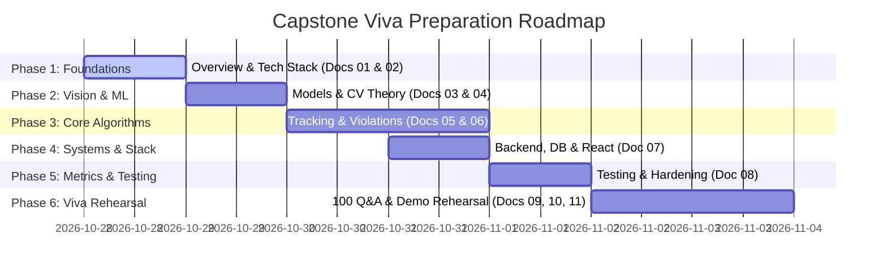

# Document 12: Master Viva Study Roadmap & Self-Assessment Guide

This document provides a structured, day-by-day study roadmap designed to help you master the entire Smart Traffic Vision project deeply, understand every engineering design choice, and defend your implementation with confidence during your university viva.

---

## 1. Six-Phase Study Schedule (7-Day Plan)



---

### Phase 1 (Day 1): Problem, Scope & Technology Justifications
- **Primary Reading**: [`01_project_overview.md`](file:///c:/Users/ASUS/OneDrive/Desktop/CV_Project_Traffic/docs/project_study/01_project_overview.md) and [`02_technology_stack.md`](file:///c:/Users/ASUS/OneDrive/Desktop/CV_Project_Traffic/docs/project_study/02_technology_stack.md).
- **Core Goals**:
  1. Memorize the 3-sentence elevator pitch: What problem does the project solve?
  2. Be able to draw the 3-tier architecture diagram on a whiteboard from memory.
  3. Know why FastAPI was chosen over Flask, and why ByteTrack was chosen over DeepSORT.
- **Hands-On Verification**:
  ```powershell
  # Check requirements and installed packages in venv
  .\.venv\Scripts\python.exe -m pip list
  ```
- **Self-Assessment Checkpoint**:
  - [ ] Can I explain why OpenCV uses BGR instead of RGB?
  - [ ] Can I list the 3 tiers and explain their separation of concerns?
  - [ ] Can I state the 6 vehicle categories supported by our system?

---

### Phase 2 (Day 2): Deep Learning Models & Computer Vision Theory
- **Primary Reading**: [`03_ml_models.md`](file:///c:/Users/ASUS/OneDrive/Desktop/CV_Project_Traffic/docs/project_study/03_ml_models.md) and [`04_computer_vision_theory.md`](file:///c:/Users/ASUS/OneDrive/Desktop/CV_Project_Traffic/docs/project_study/04_computer_vision_theory.md).
- **Core Goals**:
  1. Learn the exact classes of `vehicle_detector.pt` (6 classes) and `helmet_detector.pt` (5 classes).
  2. Understand transfer learning: acknowledge that models were fine-tuned on Roboflow datasets, **not** trained from scratch.
  3. Understand convolutions, feature maps, IoU, and Non-Maximum Suppression (NMS).
  4. Understand why classical Canny/Sobel are **not** used in modern deep learning pipelines.
- **Hands-On Verification**:
  ```powershell
  # Inspect model weights and class names live in terminal
  .\.venv\Scripts\python.exe -c "from ultralytics import YOLO; m=YOLO('models/helmet_detector.pt'); print(m.names)"
  ```
- **Self-Assessment Checkpoint**:
  - [ ] What is IoU and how does NMS use it to eliminate duplicate boxes?
  - [ ] What two neural networks comprise EasyOCR? (CRAFT + ResNet-BiLSTM-CTC)
  - [ ] What is the difference between anchor-based and anchor-free object detection?

---

### Phase 3 (Days 3 & 4): Tracking Algorithms & Safety Violation Mechanics
- **Primary Reading**: [`05_code_architecture.md`](file:///c:/Users/ASUS/OneDrive/Desktop/CV_Project_Traffic/docs/project_study/05_code_architecture.md) and [`06_detection_tracking_violations.md`](file:///c:/Users/ASUS/OneDrive/Desktop/CV_Project_Traffic/docs/project_study/06_detection_tracking_violations.md).
- **Core Goals**:
  1. Understand the ByteTrack two-stage matching algorithm (high-score matching + low-score recovery).
  2. Master the Counter-Clockwise (`ccw`) vector intersection formula for line counting.
  3. **Master the Helmet Detection Bottleneck Solution**: Explain why the overhead vehicle detector failed on frontal bikes, and how our dedicated spatial helmet-first path fixed it.
  4. Understand multi-rider disambiguation (how Motorcycle A's helmeted rider does not suppress Motorcycle B's violation).
- **Hands-On Verification**:
  ```powershell
  # Run the dedicated helmet detection test
  .\.venv\Scripts\python.exe -m pytest tests/test_helmet_e2e.py -k "test_multi_rider" -v
  ```
- **Self-Assessment Checkpoint**:
  - [ ] Can I write the `ccw(a, b, c)` formula and explain signed cross products?
  - [ ] How does our code handle competing `Helmet` and `nohelmet` boxes on the same head?
  - [ ] How does `WrongWayDetector` filter out stationary vehicles?

---

### Phase 4 (Day 5): Backend API, SQLite Database & React Dashboard
- **Primary Reading**: [`07_backend_database_frontend.md`](file:///c:/Users/ASUS/OneDrive/Desktop/CV_Project_Traffic/docs/project_study/07_backend_database_frontend.md).
- **Core Goals**:
  1. Understand the SQLite schema for the `events` table and the purpose of database indexes.
  2. Understand why `COUNT` events must never store count dictionaries in `plate_text`.
  3. Explain the React 19 component hierarchy (`OverviewPage`, `TrafficAnalysisPage`, `SafetyViolationsPage`).
  4. Explain how optimistic UI updates work when approving/rejecting infractions.
- **Hands-On Verification**:
  ```powershell
  # Query the live database to inspect recent violations
  .\.venv\Scripts\python.exe -c "import sqlite3; conn=sqlite3.connect('data/traffic_violations.db'); print(conn.execute('SELECT id, event_type, track_id, confidence FROM events ORDER BY id DESC LIMIT 5').fetchall())"
  ```
- **Self-Assessment Checkpoint**:
  - [ ] What HTTP status code is returned if an operator tries to review a `COUNT` event? (HTTP 400)
  - [ ] How does the video player synchronize vehicle count graphs with playback time?
  - [ ] What is Pydantic and how does it enforce type safety in FastAPI?

---

### Phase 5 (Day 6): Testing, Verification & Metrics
- **Primary Reading**: [`08_testing_and_evaluation.md`](file:///c:/Users/ASUS/OneDrive/Desktop/CV_Project_Traffic/docs/project_study/08_testing_and_evaluation.md).
- **Core Goals**:
  1. Memorize test statistics: **52 automated pytest tests passing in 8.5 seconds**.
  2. Memorize evaluation figures: **93.3% recall (14/15)** on unhelmeted riders, **0.0% false alarms (0/15)** on compliant riders.
  3. Know the mathematical formulas for Precision, Recall, F1-Score, and False Positive Rate.
  4. Explain why passing unit tests do not equal 100% real-world accuracy.
- **Hands-On Verification**:
  ```powershell
  # Run the full test suite
  .\.venv\Scripts\python.exe -m pytest tests/ -v --tb=short
  
  # Run frontend production build
  cd frontend && npm run build
  ```
- **Self-Assessment Checkpoint**:
  - [ ] What is the difference between Precision and Recall?
  - [ ] What discrepancy exists between the README and the current test suite? (README states 25; code has 52)
  - [ ] What three real-world environmental factors degrade vision accuracy on live roads?

---

### Phase 6 (Day 7): Viva Practice, Presentation & Live Demo Rehearsal
- **Primary Reading**: [`09_team_contribution.md`](file:///c:/Users/ASUS/OneDrive/Desktop/CV_Project_Traffic/docs/project_study/09_team_contribution.md), [`10_viva_questions_answers.md`](file:///c:/Users/ASUS/OneDrive/Desktop/CV_Project_Traffic/docs/project_study/10_viva_questions_answers.md), and [`11_presentation_and_demo.md`](file:///c:/Users/ASUS/OneDrive/Desktop/CV_Project_Traffic/docs/project_study/11_presentation_and_demo.md).
- **Core Goals**:
  1. Practice speaking the 118 viva answers out loud in clear, formal English.
  2. Rehearse the 5–7 minute live demo script from start to finish at least three times.
  3. Know the exact speaking points for each team member (Main Developer 55%, Ruchi 25%, Afzal 20%).
  4. Memorize the rapid troubleshooting fixes for port conflicts and codec issues.
- **Hands-On Verification**:
  - Perform a complete mock demo from a cold machine reboot.

---

## 2. Final Viva Day Checklist (Before Entering the Room)

- [ ] **FastAPI Backend Verified**: Uvicorn is running on `127.0.0.1:8000` with no port binding errors.
- [ ] **React Dev Server Verified**: Vite is running on `http://localhost:5173` and connected to the backend.
- [ ] **Sample Video Ready**: `data/input/helmet_test.mp4` is present and ready for upload.
- [ ] **Plate Image Ready**: At least one clear license plate JPEG is ready for the Plate Scanner demo.
- [ ] **Evidence Files Verified**: Evidence snapshots exist in `data/output/violations/` and open cleanly.
- [ ] **Codec DLL Verified**: `openh264-2.5.0-win64.dll` is in the project root.
- [ ] **Full Test Suite Clean**: `pytest tests/` runs with 52 passed.
- [ ] **Tone Prepared**: Speak with technical precision, acknowledge real-world vision limitations with academic honesty, and emphasize our dedicated helmet bottleneck resolution.
